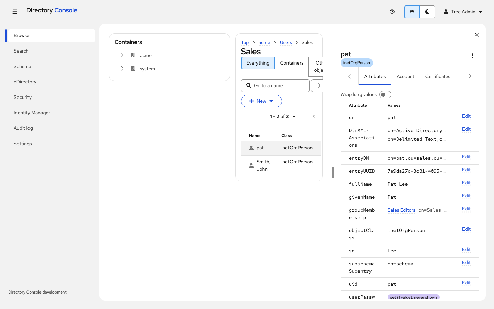

# Directory Console

> **Beta.** Directory Console is a beta release. It is in active use against lab and test trees, but expect rough
> edges and changes between versions. Try it on a non-production tree first, and see
> [docs/STATUS.md](docs/STATUS.md) for what works and what does not yet.

A web console for NetIQ/OpenText **eDirectory** and **Identity Manager**: one Java 21 server. It is published as a
container image, the recommended way to run it.

- **Directory objects:** browse, search, edit and manage objects.
- **eDirectory administration:** schema, partitions and replicas, indexes, LDAP servers, auditing, SNMP, encryption, password policies and certificates.
- **Identity Manager:** run and inspect drivers and jobs.

Every action runs with the signed-in person's own eDirectory rights, and every change is audited.



More screenshots: [docs/SCREENSHOTS.md](docs/SCREENSHOTS.md).

- **Install:** [docs/QUICKSTART.md](docs/QUICKSTART.md) to try it with Docker (Docker Desktop on Windows too);
  [docs/DEPLOYING.md](docs/DEPLOYING.md) for a lasting install.
- **Upgrade:** [docs/UPGRADING.md](docs/UPGRADING.md).
- **What works today, and what does not yet:** [docs/STATUS.md](docs/STATUS.md).

## Install

You need an eDirectory tree whose LDAPS port the console can reach, and one of these:

| Way | For | Guide |
|---|---|---|
| **Docker** (with compose) | Recommended: trying it, and a lasting install on a server | below, then [QUICKSTART](docs/QUICKSTART.md) and [DEPLOYING](docs/DEPLOYING.md#2-run-it-on-a-server-with-docker) |
| **Kubernetes** | Clusters | [DEPLOYING](docs/DEPLOYING.md#3-run-it-on-kubernetes), with [`kubernetes.yaml`](container/kubernetes.yaml) |
| **Plain Java 21**, no container | Possible, but strongly discouraged: every update is a manual job, and Java and the hardening are yours to keep | [DEPLOYING](docs/DEPLOYING.md#10-without-a-container-not-recommended) |

With Docker: get [`compose.yaml`](compose.yaml) (also attached to each [release](../../releases/latest)), then:

```bash
docker compose up -d
docker compose logs console
```

The log prints a setup link. Open it, check the certificate fingerprint it shows, and sign in to your tree
as an administrator. That tree becomes the console's first directory, and that administrator its break-glass
account. You can add more directories (dev, test, production) later under **Settings > Directories**. The
[quickstart](docs/QUICKSTART.md) walks through every step; [DEPLOYING.md](docs/DEPLOYING.md) covers a lasting
install, with or without single sign-on.

The image is `ghcr.io/pointbluetechnology/directory-console`, for amd64 and arm64. Tags:
- `latest` and `<version>`: each release;
- `main`: the newest commit.

## Upgrade

Administrators see a banner when a newer release is out, and the console's version is at the foot of the
navigation. To upgrade a compose install, back up the data volume, then run:

```bash
docker compose pull
docker compose up -d
```

**[docs/UPGRADING.md](docs/UPGRADING.md)** has the full steps:
- backing up and restoring the data volume, on Windows too;
- upgrading a `docker run` install;
- pinning a version;
- going back;
- outbound connections, and consoles without internet access.

## Features

- **Directory objects:**
  - browse the tree and search, with sorted, paged results even in large containers;
  - view and edit attributes;
  - create users, groups and any object class;
  - rename, move and delete;
  - add auxiliary classes, including their mandatory attributes;
  - see effective rights;
  - account tasks: enable, unlock, reset a password;
  - group membership.
- **eDirectory administration:**
  - the schema: browse it, and add classes and attributes, with their flags;
  - partitions and replicas, and replica filters;
  - servers and their indexes: add, take offline and back, copy to other servers;
  - LDAP servers and groups, with refresh and reload;
  - CEF auditing settings and SNMP traps;
  - encrypted attribute policies;
  - password policies, challenge sets, login methods and enhanced background authentication.
- **Certificates:**
  - the organizational CA and its configuration;
  - server and user certificates;
  - repair of the default server certificates;
  - CRLs;
  - export with the private key (PKCS#12);
  - a daily expiry check, with e-mail and signed webhook notices;
  - the console's own certificate from an ACME CA (Let's Encrypt or internal), proven with DNS-01, and renewed automatically.
- **Identity Manager:**
  - **driver sets and drivers:** state, start and stop (one at a time or all), start options, trace and log levels, named passwords, read-only properties, statistics and versions;
  - **jobs:** run, abort, create, edit and delete;
  - **inspection:** the cache inspector, the association inspector, the object inspector, and per-user password synchronization status;
  - **data:** migrate and synchronize, and mapping tables.
- **Sign-in and access:**
  - direct sign-in, or single sign-on with OpenID Connect, optionally the only way in except for listed accounts;
  - several directories, chosen at sign-in;
  - role mappings from eDirectory groups to four roles, optionally limited to containers: viewer, editor, operator (Identity Manager) and admin;
  - task presets for delegated work;
  - break-glass accounts.
- **Help:** the ? in the header explains the page you are on; hover hints explain terms and fields.

## How it works

- **Your own rights:** the console signs in to eDirectory as the person using it, over LDAPS, so eDirectory
  applies their own rights. Single sign-on finds the person with a service account, then acts as them
  with the LDAP proxied-authorization control.
- **Identity Manager:** the console talks to the engine on the server you signed in to, as you (under
  single sign-on too, through the same proxied authorization), with
  [DirXMLDev](https://github.com/PointBlueTechnology/DirXMLDev) over the open-source JLDAP library.
  Nothing needs to be installed or mounted, and the image contains no OpenText code.
- **Trust:** the console makes its own TLS certificate on first start, and prints its fingerprint so you
  can check it. Directory certificates are trusted only after you confirm their fingerprint, and the
  console keeps its own trust store.
- **Records:**
  - **Configuration:** versioned, and secrets in it are encrypted.
  - **Audit log:** hash-chained, so tampering shows, and can be forwarded to syslog as CEF.
  - **Writes:** each one is audited with attribute names, never values.
- **Hardened container:** distroless Java 21 as a non-root user, with a read-only root file system. Everything
  the console keeps is in one data folder (the `/data` volume in the container).

## Configuration

Almost everything is configured in the console itself. The server takes a few environment variables (set in
`compose.yaml`, the Kubernetes manifest, or the service's environment without a container):

| Variable | Default | Meaning |
|---|---|---|
| `CONSOLE_PUBLIC_URL` | `https://localhost:8443` | How browsers reach the console; its host name goes into the console's certificate. |
| `CONSOLE_PORT` | `8443` | The HTTPS port it listens on (inside the container, when in one). |
| `CONSOLE_DATA` | `/data` | Where the configuration, certificates and audit log are kept: owner-only, and only one console at a time. |
| `HTTPS_PROXY` | none | A proxy for the release check and webhooks. |
| `CONSOLE_UPDATE_URL` | GitHub's latest-release API | Where the release check looks; for a mirror. |

The console's outbound connections are listed in [UPGRADING.md](docs/UPGRADING.md#outbound-connections-and-air-gapped-consoles).

Administration commands. With compose, run them in the folder with `compose.yaml`:

```bash
docker compose exec console java -jar /app/console.jar admin verify-audit      # check the audit chain
docker compose exec console java -jar /app/console.jar admin reset-bootstrap   # set up again on the next start
```

On Kubernetes, the same through `kubectl exec`; without a container, `java -jar console.jar admin …` with the same
`CONSOLE_DATA` ([DEPLOYING](docs/DEPLOYING.md)).

## Building from source

You need JDK 21, Maven, Node.js 24 and Docker. The server builds on two Point Blue libraries,
[DirXMLDev](https://github.com/PointBlueTechnology/DirXMLDev) and
[DirXMLSimulator](https://github.com/PointBlueTechnology/DirXMLSimulator). Install their releases into
your local Maven repository at the versions named in [`pom.xml`](pom.xml) (`dirxmldev.version`,
`simulator.version`), as [CI does](.github/workflows/test.yml). Then:

```bash
container/build.sh
```

`container/build.sh` does the following:
1. builds and tests the web UI;
2. builds and tests the Java modules;
3. checks that no OpenText class is included;
4. builds the image `directory-console:<version>`.

To run your build, use `CONSOLE_IMAGE=directory-console:<version> docker compose up -d`.

### Working on the web UI

```bash
cd console-web
npm ci --ignore-scripts
npm run dev       # http://localhost:5173, proxying /api to a console at https://localhost:8443 (CONSOLE_URL)
npm test
npm run build
```

The development server enforces the console's own content security policy, so a component that needs
inline script or style fails during development.

For a console to develop against without a real tree, run `DemoServer` from the server's test sources.
It is an in-memory directory with a sample tree and a stand-in Identity Manager engine, on port 8443.
Sign in as `cn=admin,o=system` / `admin-pw`, or `viewer` / `viewer-pw` for the read-only role.

### Layout

| Module | What |
|---|---|
| `console-server` | The service: the HTTPS API, sign-in, trust, configuration, audit, and the eDirectory and Identity Manager operations. |
| `console-web` | The web UI: React and PatternFly 6, built into the server's jar. |
| `console-auth` | OpenID Connect sign-in and merged TLS trust; also used by DirXMLDevWeb. |
| `console-theme` | Point Blue's PatternFly design tokens; also used by DirXMLDevWeb. |
| `container` | The image and its build script. |
| `docs` | The [quickstart](docs/QUICKSTART.md), [deploying](docs/DEPLOYING.md), [upgrading](docs/UPGRADING.md), [status](docs/STATUS.md), [API notes](docs/API.md) and [screenshots](docs/SCREENSHOTS.md). |

### Lab checks

The `Live*Check` and `LivePkiStep` classes in the server's test sources are not unit tests. They drive the
real server against a lab tree described in a DirXMLDev `environments.properties` file, and are for the
maintainers' own test trees. `LivePkiStep` writes only to environments named in `-Dlive.writable`.

## Releases

Each release publishes:
- the image, with its version tag and `latest`;
- the release itself, with its notes, `compose.yaml`, `THIRD-PARTY-NOTICES.md` and `console-auth-<version>.jar` attached.

Read the notes of each release you skip before upgrading; see [docs/UPGRADING.md](docs/UPGRADING.md).

## Security

Please report vulnerabilities privately; see [SECURITY.md](SECURITY.md).

## License

[MIT](LICENSE). The image and the web UI also contain third-party components under their own licenses; see
[THIRD-PARTY-NOTICES.md](THIRD-PARTY-NOTICES.md).

Directory Console is made by [Point Blue Technology](https://pointbluetech.com). It is not affiliated with,
endorsed by or supported by OpenText. NetIQ, eDirectory, Identity Manager and OpenText are trademarks of
OpenText or its affiliates; other names belong to their owners.
